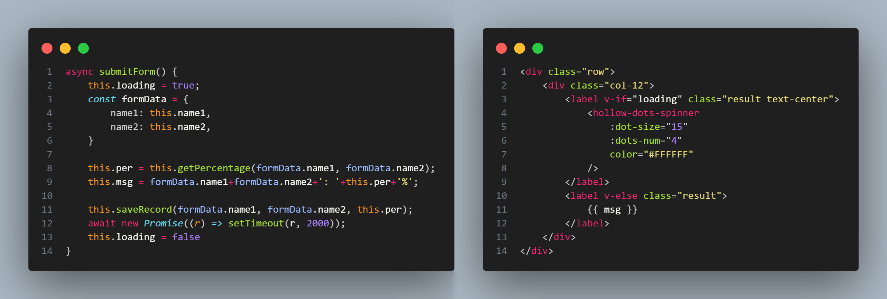
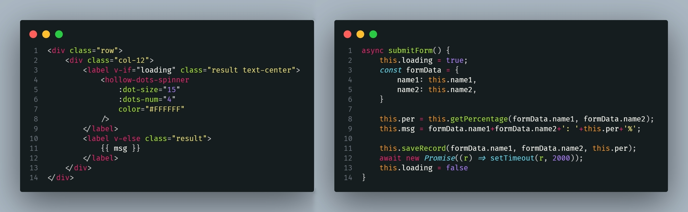
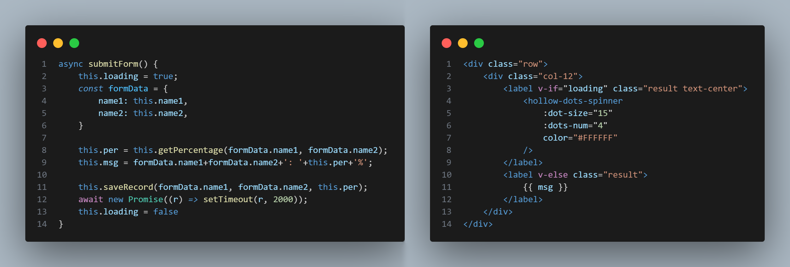
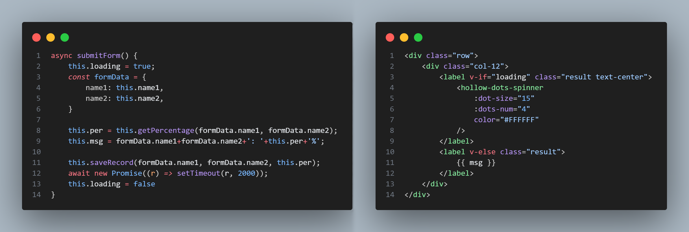
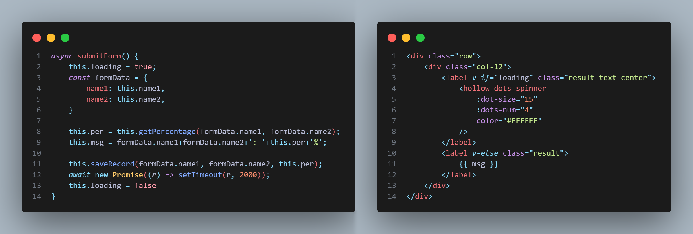
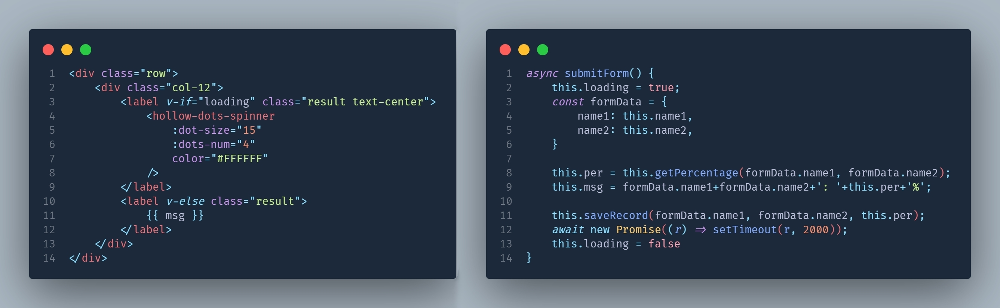
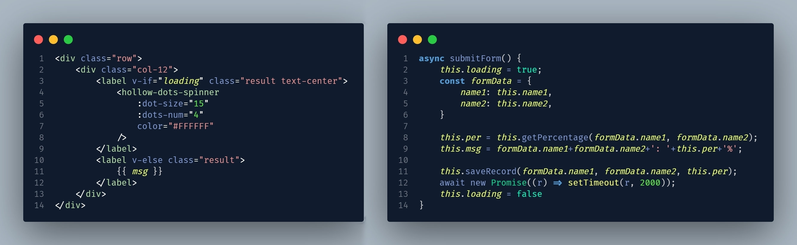
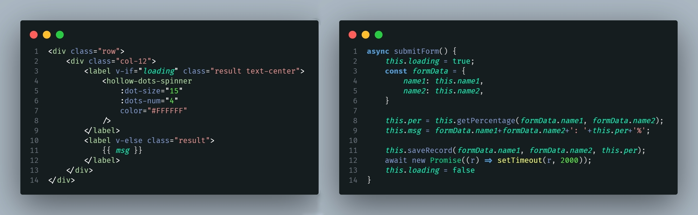

  

<h1 align="center">Buzzokai Dimmed</h1>

<strong>A darker canvas. Eight distinct palettes.</strong>

  Familiar syntax colors, dimmed backgrounds, and a palette for your kind of dark.

  <a href="https://marketplace.visualstudio.com/items?itemName=HRIDOY-BUZZ.buzzokai-dimmed"><strong>Get the extension</strong></a>
  &nbsp;·&nbsp;
  <a href="#find-your-palette">Explore the themes</a>
  &nbsp;·&nbsp;
  <a href="https://github.com/HRIDOY-BUZZ/buzzokai-dimmed/blob/master/CHANGELOG.md">What's new</a>

---

## Make yourself at home

Go neutral with **Mono Dark**, add a cool tint with **Liquid Blue**, or bring a little green to your workspace with **Hydrogen Green**. Buzzokai Dimmed brings together eight dark themes with TextMate syntax colors and semantic highlighting support.

- **Eight palettes, one extension.** Switch between neutral, blue, and green backgrounds without installing separate themes.
- **Desktop and browser support.** Use the themes in VS Code on your desktop or in its browser extension host.
- **Works in Restricted Mode.** Choose a theme without granting workspace trust.
- **Settings that respect your workspace.** Theme commands update an existing workspace theme setting; otherwise, they update your user default.

## Get started

1. Open **Extensions** in VS Code and search for **Buzzokai Dimmed**, or visit the [Marketplace page](https://marketplace.visualstudio.com/items?itemName=HRIDOY-BUZZ.buzzokai-dimmed).
2. Install the extension by **HRIDOY-BUZZ**.
3. Open the **Command Palette**, type `Buzzokai`, and select a theme.

| Windows / Linux | macOS |
| --- | --- |
| `Ctrl` + `Shift` + `P` | `Cmd` + `Shift` + `P` |

You can also use **Preferences: Color Theme** to preview the palettes before choosing one.

## Find your palette

Eight ways to make the editor yours. Each preview shows a theme from the collection.

| **Buzzokai Mono Dark** | **Buzzokai Mono Green** |
| --- | --- |
| A neutral dark canvas with a vibrant syntax palette. | The Mono palette with green-tinted surfaces. |
|  |  |

| **Buzzokai Reversed Dark** | **Buzzokai GitHub Dark** |
| --- | --- |
| Familiar dark-editor colors with a different take on syntax. | GitHub-inspired syntax on a neutral dark background. |
|  |  |

| **Buzzokai Material Dark** | **Buzzokai Material Blue** |
| --- | --- |
| A colorful Material-inspired palette on charcoal surfaces. | The Material syntax palette with a cool blue backdrop. |
|  |  |

| **Buzzokai Liquid Blue** | **Buzzokai Hydrogen Green** |
| --- | --- |
| Deep navy surfaces with bright syntax accents. | Dark green surfaces with a colorful syntax palette. |
|  |  |

> **Coming from an older release?** Liquid Blue was previously named Shopify Blue, and Hydrogen Green was Shopify Green. After updating to the renamed themes, select the new name once. Update any theme-specific customizations that still use an old name. Existing command IDs remain available for custom keybindings.

## A few things to know

**Your workspace, your choice.** When you use a Buzzokai command, an existing workspace theme override is updated while your user default stays intact. Without an override, the command changes your user theme and leaves workspace settings alone.

**Syntax follows your tools.** TextMate grammars and language extensions determine which tokens receive colors. Semantic highlighting adds language-aware colors when your language extension supplies them.

**Make it personal.** VS Code's `workbench.colorCustomizations` and `editor.tokenColorCustomizations` settings let you adjust UI and syntax colors without editing the extension.

**Compatibility.** Requires VS Code **1.75.1 or newer in the 1.x series**. See the [changelog](CHANGELOG.md) for release details.

## Help shape the next release

Found a color that feels out of place? Include the theme name, language, and a small code sample when [reporting an issue](https://github.com/HRIDOY-BUZZ/buzzokai-dimmed/issues). Screenshots are welcome.

[Report a bug](https://github.com/HRIDOY-BUZZ/buzzokai-dimmed/issues) · [Start a discussion](https://github.com/HRIDOY-BUZZ/buzzokai-dimmed/discussions) · [Contribute on GitHub](https://github.com/HRIDOY-BUZZ/buzzokai-dimmed)

If Buzzokai has found a place in your setup, a [Marketplace review](https://marketplace.visualstudio.com/items?itemName=HRIDOY-BUZZ.buzzokai-dimmed) helps others discover it.

---

Released under the [MIT License](LICENSE.md). This collection includes forks and adaptations of familiar themes, including Monokai, Material, GitHub, and VS Code's dark themes. Thanks to the theme authors and contributors whose work inspired Buzzokai.
